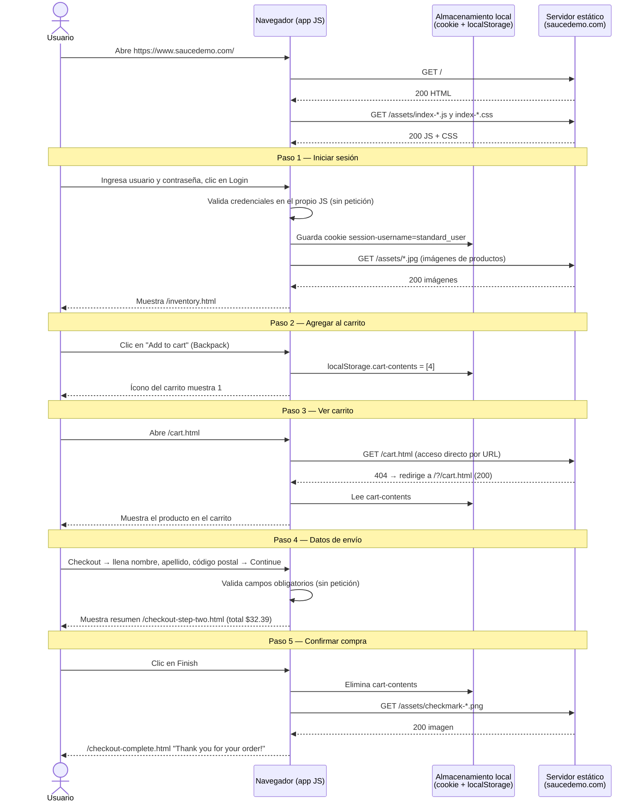

# Swag Labs — Flujos críticos

**Proyecto:** https://www.saucedemo.com/ (Swag Labs)
**Autor:** Carlos Daniel Pingus Rodriguez
**Fecha de captura:** 07/10/2026
**Usuario de prueba:** `standard_user`

---

## 1. Diagrama cliente-servidor — Flujo crítico: Compra (checkout)

**¿Por qué es crítico?** El objetivo de Swag Labs es vender productos. Si el checkout falla, el usuario no puede completar una compra, es decir, no cumple el objetivo del sistema. El flujo incluye login y carrito como pasos previos obligatorios.

**Hallazgo de arquitectura:** Swag Labs es una aplicación de una sola página (SPA) alojada como sitio estático. El servidor solo entrega archivos (HTML, JS, CSS, imágenes). La lógica de negocio corre en el navegador y el estado se guarda en:

| Dato | Dónde se guarda | Valor observado |
|---|---|---|
| Sesión | Cookie `session-username` | `standard_user` |
| Carrito | `localStorage.cart-contents` | `[4]` (id de Sauce Labs Backpack) |



---

## 2. Tabla de endpoints

> **Nota:** Swag Labs **no expone peticiones a una API** (no hay `POST /login`, `POST /cart` ni `POST /order`). Login, carrito y compra se resuelven en el navegador. Las peticiones registradas en DevTools → Network son solo de archivos estáticos y telemetría de terceros. Se documentan las peticiones reales observadas durante el flujo de checkout.

| # | Flujo | Acción | Método | Endpoint | Código |
|---|---|---|---|---|---|
| 1 | Carga inicial | Abrir la página de login | GET | `https://www.saucedemo.com/` | 200 |
| 2 | Carga inicial | Descargar la lógica de la app | GET | `/assets/index-D3OxT1jE.js` | 200 |
| 3 | Carga inicial | Descargar estilos | GET | `/assets/index-aSZoiKGF.css` | 200 |
| 4 | Iniciar sesión | Cargar imagen de producto en el inventario | GET | `/assets/sauce-backpack-1200x1500-CjRW-Djj.jpg` | 200 |
| 5 | Ver carrito | Abrir el carrito por URL directa | GET | `/cart.html` | 404 |
| 6 | Ver carrito | Redirección de la ruta a la SPA | GET | `/?/cart.html` | 200 |
| 7 | Confirmar compra | Cargar ícono de compra exitosa | GET | `/assets/checkmark-VLWQafip.png` | 200 |
| 8 | Telemetría | Reporte de eventos al servicio externo | POST | `https://events.backtrace.io/api/unique-events/submit` | — |

**Acciones sin petición de red:** agregar al carrito, llenar el formulario de envío, pulsar Continue y pulsar Finish.

**Observación para pruebas:** como no hay API, las validaciones del flujo se verifican en la interfaz y en el almacenamiento del navegador (cookie y `localStorage`), no con códigos de estado HTTP.

---

## 3. Plantilla de caso de prueba

```text
CLASE CasoDePrueba
    ATRIBUTOS
        id                  : Texto        // Ej. "CP-SL-001"
        titulo              : Texto
        flujo               : Texto        // Login | Carrito | Checkout
        prioridad           : Texto        // Alta | Media | Baja
        tipo                : Texto        // Positivo | Negativo
        precondiciones      : Lista<Texto>
        datosDePrueba       : Diccionario<Texto, Texto>
        pasos               : Lista<Texto>
        resultadoEsperado   : Texto
        resultadoObtenido   : Texto
        estado              : Texto        // Pendiente | Aprobado | Fallido | Bloqueado
        evidencia           : Texto        // Ruta a captura o video

    MÉTODOS
        ejecutar()                         // Sigue los pasos y registra resultadoObtenido
        compararResultado() : Booleano     // resultadoObtenido == resultadoEsperado
        marcarEstado(nuevoEstado : Texto)
FIN CLASE
```

### Objeto de ejemplo

```text
cp001 = NUEVO CasoDePrueba(
    id                = "CP-SL-001",
    titulo            = "Compra exitosa de un producto con usuario estándar",
    flujo             = "Checkout",
    prioridad         = "Alta",
    tipo              = "Positivo",
    precondiciones    = [
        "El sitio https://www.saucedemo.com/ está disponible",
        "El carrito está vacío"
    ],
    datosDePrueba     = {
        "usuario": "standard_user",
        "producto": "Sauce Labs Backpack",
        "nombre": "Test",
        "apellido": "QA",
        "codigoPostal": "15001"
    },
    pasos             = [
        "1. Iniciar sesión con standard_user",
        "2. Pulsar 'Add to cart' en Sauce Labs Backpack",
        "3. Abrir el carrito y pulsar 'Checkout'",
        "4. Llenar nombre, apellido y código postal, y pulsar 'Continue'",
        "5. Verificar el resumen: Item total $29.99, Tax $2.40, Total $32.39",
        "6. Pulsar 'Finish'"
    ],
    resultadoEsperado = "Se muestra 'Thank you for your order!' y el carrito queda vacío",
    resultadoObtenido = "Se muestra 'Thank you for your order!'; localStorage.cart-contents eliminado",
    estado            = "Aprobado",
    evidencia         = "evidencias/CP-SL-001_checkout_complete.png"
)
```
